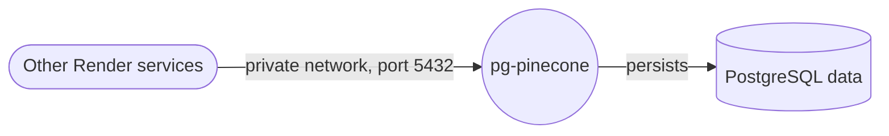

# pg_pinecone

PostgreSQL 18 with pg_pinecone already installed. One private service, a disk for the data, and the same SQL as pgvector.

## Why deploy pg_pinecone on Render?

[pg_pinecone](https://github.com/pinecone-io/pg_pinecone) is an open-source Postgres extension for search on the data you already store, built on the search engine Pinecone runs at scale. You use the same SQL as pgvector. A filter such as a tenant applies during the search, and the rows stay in Postgres. When a table needs more scale, send its search to Pinecone as a [remote backend](https://www.pinecone.io/blog/introducing-pg-pinecone/). Your queries stay the same.

This template starts that database for you. Render keeps the files on a disk and gives your other services a private address. Nothing is exposed to the public internet. The image does not speak TLS, so the database stays on the private network.

You get search inside Postgres from one deploy. Connect with the private URL, query with the SQL you already use, and add Pinecone as a remote backend when you need more scale.

## Architecture



## What you can build

You get a Postgres 18 database with the `vector` and `pg_pinecone` extensions installed and `pg_pinecone` preloaded. The quickstart below runs inside Postgres. A Pinecone API key is optional. It adds a remote backend, `embed()`, keyword search, search that combines keywords with vectors, and `rerank()`.

```sql
CREATE TABLE items (
    id bigint PRIMARY KEY,
    embedding vector(3)
);

INSERT INTO items VALUES (1, '[1,2,3]'), (2, '[4,5,6]'), (3, '[7,8,9]');

SELECT pinecone.create_index('items', 'embedding');

SELECT id FROM items ORDER BY embedding <=> '[1,2,4]' LIMIT 2;
```

## Key features

- One private Postgres 18 service from the public `pineconeteam/pg_pinecone:pg18` image, with pgvector and pg_pinecone installed.
- A disk mounted at `/var/lib/postgresql`, which is where Postgres 18 keeps the cluster (`/var/lib/postgresql/18/docker`).
- The same SQL as pgvector. A filter such as a tenant applies during the search, and the rows stay in Postgres.
- When a table needs more scale, send its search to Pinecone as a remote backend. Queries stay the same.
- A URL-safe password generated for each deploy and stored on the disk. Other services in the same workspace and region reach the database on the private network, on port 5432.

## Use cases

- Find the records behind a support assistant, a recommendation, or an agent that remembers past work
- Search by meaning inside Postgres, with the same SQL as pgvector
- Limit a search to one tenant, user, or category while still filling the result list
- Keep embeddings in Postgres, and send search to a remote backend when a table needs more scale
- With a Pinecone API key, add `embed()`, keyword search, search that combines keywords with vectors, and `rerank()`

## Next steps

1. Open the Shell for the `pg-pinecone` service and read `/var/lib/postgresql/.private_database_url`. That is the private connection URL. It uses port 5432 and is only reachable from other services in the same workspace and region.
2. Run the SQL in "What you can build". The last query returns ids 1 and 2.
3. When a table needs more scale, store a Pinecone API key with `SELECT pinecone.set_api_key('...');` and send that table's search to Pinecone as a remote backend. Queries stay the same.

## Resources

- [Introducing pg_pinecone](https://www.pinecone.io/blog/introducing-pg-pinecone/)
- [pg_pinecone on GitHub](https://github.com/pinecone-io/pg_pinecone)
- [Documentation](https://docs.pinecone.io/guides/pg-pinecone/overview) and [quickstart](https://docs.pinecone.io/guides/pg-pinecone/quickstart)
- Docker image: [pineconeteam/pg_pinecone](https://hub.docker.com/r/pineconeteam/pg_pinecone)
